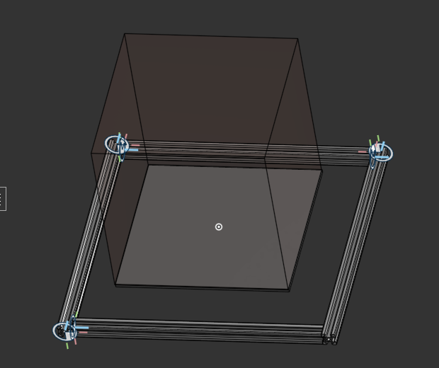
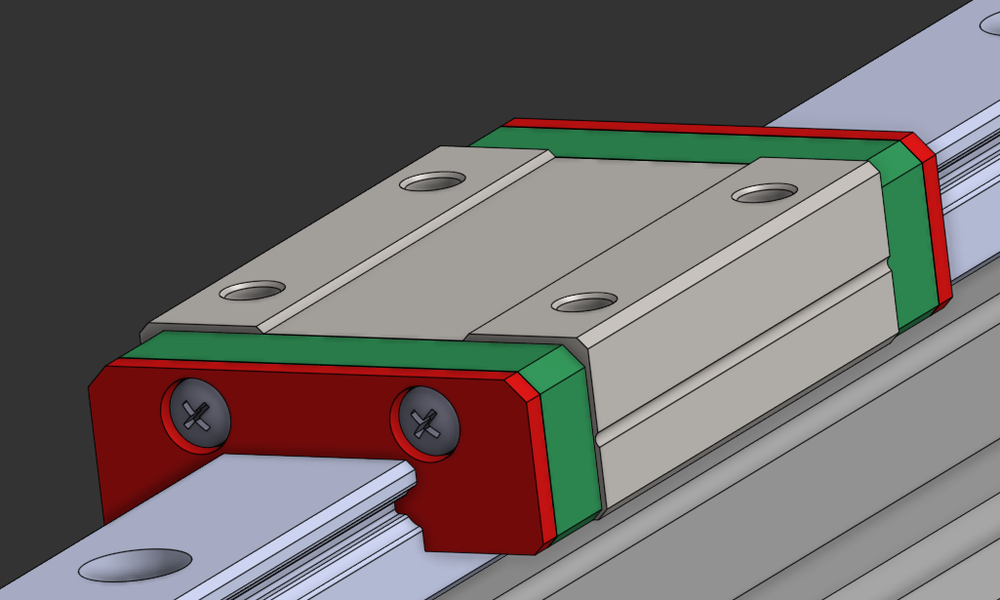
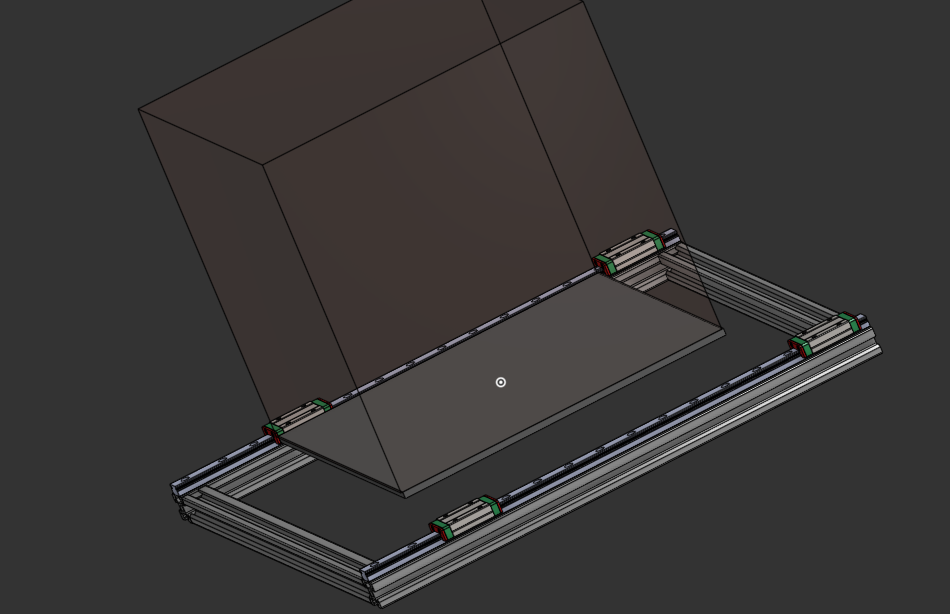
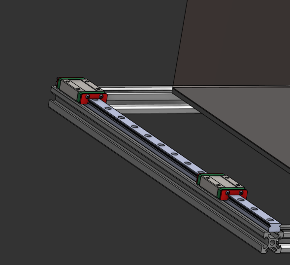

# 25.10.26 Initialized the repository and started to set up the project
not really anything interesting to say.i cloned the project from github to my local device and started to set up the directories and the readmes to sync and my onshape. not really anything special or exciting so heres a picture of a cat

**Total time spent: 10 mins**

# 25.10.26 Initialized the repository and started to set up the project
Well that took a while. Ive never used onshape properly before and whilst onb this topic i am SO bad at 3d cad so welp. Fristly i got a box that is 256 x 256 x 256 which would show what area i would need to keep free for actual prints(hence the print volum is 256mm*3). I took a while to get the 3d models for the 2020 extrusions and then made a few different parts to use in my assembly including 400mm 370mm and 440mm of 2020 extrusions. I also got a stepper motor model from grabcad community library to use in the future. i put all the extrusions in a folder in onshape for doc cleanliness and then started the assembly and holy shit i didnt know what i was doing. firstly i stacked a 256x256x5 plate under the print volume box as a placeholder for the base plate. (i choose 256xxx as its the bambu a1 size so i can source the parts from replacment a1 parts like the heated base or base plate). i then tried mate connectors last night to make an equal rectangle base with the 400 x 370mm rectangle extrusions and i just couldnt last night. i decided to go sleep as it was like flipping 2am and today morning (i 4got to lapse this) i managed to get the mate connectors to work:

**Total time spent: 1 hour 30 mins**

# 26.10.26 Added the base rails (MGN12) and the blocks (MGN12H)
OH MY DAYS MATE CONNECTORS ARE SO EASY AND SICKKK... but it took me like an hour of watching yt vids to learn how to use them. Anyways firstly i added both rails on he top part of the left and right base extrusions. These will hold the sliding blocks (i chose MGN12H for rigidity (is that a word ??)) and will let the base plate slide on the y 3d printing axis. Importing the rails was easy enough but getting the blocks to slide cleanly was not easy enough :( For the rails i just fasten matted them to the top part of the extrusions and the blocks i used a sliding mate which yh took me a while to learn how to use. I also made my onshape document clean by sorting everything in to subassemblies(the block cause it came in like a bajillion parts) and folders. Hopefully that made the onshape doc look less like a mess. ANYWAYS hers so *eyecandy*:

The lapse doesn't match with the time by a bit cause i forgot to lapse (only like a 5-10 min difference tho)

I kept two blocks on each rail so the bed doesnt wobble(its gonna be 256x256 so if i only use one block it might see-saw whilst printing and that no good).

**Total time spent: 1 hour**

